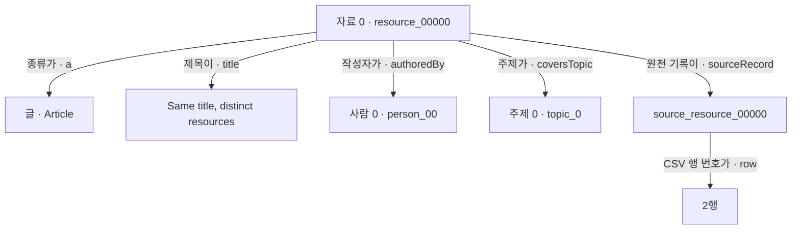

# 온톨로지 경량화 실습 자료

**스터디에서 읽을 글과 들을 강의를 모아 둔 목록**을 생각해 보세요. 자료마다 제목, 작성자, 주제가 있습니다. 글과 강의를 함께 찾기도 하고, 작성자를 빠뜨린 자료를 찾기도 합니다.

이 실습은 그 목록을 그래프로 옮긴 뒤 **크기를 줄여도 자료의 종류·작성자·주제·출처를 제대로 찾을 수 있는지** 확인합니다. 모든 입력은 실습용으로 만든 가상 자료입니다.

## 처음에는 이 순서로 보세요

처음 한 번은 아래 다섯 단계만 따라가면 됩니다. 이 README의 예제 설명을 읽은 뒤 작은 파일부터 여세요.

| 순서 | 볼 곳 | 확인할 질문 |
| --- | --- | --- |
| 1 | 이 README의 예제 설명과 ‘TTL 파일을 처음 읽을 때’ | 목록 한 행은 무엇을 뜻할까? |
| 2 | [source-20.csv](source-20.csv) | 글·강의 20건에 제목·작성자·주제가 어떻게 적혀 있을까? |
| 3 | [ontology.ttl](ontology.ttl) | 글과 강의를 어떤 종류로 분류하고, 관계에 어떤 뜻을 부여했을까? |
| 4 | [graph-20.ttl](graph-20.ttl)에서 resource_00000 찾기 | 같은 자료 한 건이 그래프에서는 어떻게 표현될까? |
| 5 | 아래 ‘20건으로 실행해 보기’ | 변환·경량화 후에도 같은 자료를 찾을까? |

전체 Python 코드를 이해하는 작업은 이 순서 뒤에 두었습니다. 1,000건·5,000건 자료와 상세 JSON은 작은 예제를 본 뒤 비교할 때 쓰면 됩니다.

## 예제에 들어 있는 것

목록에는 **글 10개와 강의 10개**가 있습니다. 같은 입력의 반복을 확인하려고 두 행을 더 넣었으므로 CSV에는 헤더를 제외하고 22행이 있습니다.

| 예제의 이름 | 뜻 |
| --- | --- |
| resource_00000 같은 ID | 글이나 강의 하나를 가리키는 자료 번호 |
| Article | 글 |
| Course | 강의 |
| TextResource | 글처럼 텍스트로 된 자료라는 상위 분류 |
| LearningResource | 글과 강의를 함께 부르는 학습 자료라는 상위 분류 |
| person_00 같은 ID | 작성자를 구별하는 번호 |
| topic_0 같은 ID | 자료의 주제를 구별하는 번호 |
| source_resource_00000 | 이 자료가 원천 CSV의 어느 행에서 왔는지 가리키는 기록 |

person_00에 실제 사람 이름이 붙어 있거나 topic_0가 특정 기술을 뜻하는 것은 아닙니다. **작성자와 주제의 연결을 시험하기 위한 임의의 번호**입니다. Learning material 2 같은 제목도 실제 문서 제목이 아닌 생성된 문자열입니다.

## 왜 사실을 세 자리로 나눌까

CSV에서는 자료 한 건의 종류·제목·작성자·주제를 한 행에 모았습니다. RDF로 옮길 때는 그 내용을 관계별로 나눕니다. ‘자료 0의 작성자는 사람 0이다’를 예로 들면 다음 세 자리가 필요합니다.

```text
(자료 0, 작성자가, 사람 0)
   주어     술어     목적어
```

주어(subject)는 설명할 대상, 술어(predicate)는 어떤 관계인지, 목적어(object)는 연결할 개체나 값입니다. 세 자리를 묶은 RDF의 단위를 트리플(triple)이라고 합니다. 그래프로 그리면 자료 0과 사람 0이 양쪽 노드가 되고, authoredBy가 둘을 잇는 화살표의 이름이 됩니다. [W3C RDF의 트리플 정의](https://www.w3.org/TR/rdf11-concepts/#section-triples)

세 자리의 순서에도 뜻이 있습니다. ‘자료 0 → 작성자가 → 사람 0’에서 앞뒤를 바꾸면 ‘사람 0의 작성자가 자료 0이다’라는 다른 주장입니다. 세 값을 순서 없이 모아 두는 것과는 다릅니다.

이렇게 나누면 작성자가 같은 여러 자료를 같은 사람 식별자에 연결할 수 있습니다. ‘사람 0이 작성한 자료는 무엇인가?’를 물을 때는 authoredBy의 목적어가 person_00인 연결을 찾으면 됩니다. 자료에 주제나 출처를 덧붙일 때도 같은 자료 식별자를 주어로 둔 트리플을 추가합니다. 제목은 문자열 값에, 작성자는 사람 개체에 연결한다는 차이도 각 관계에 드러납니다.

Python 코드의 튜플(tuple)은 값을 순서대로 묶는 표현입니다. 이 실습에서 RDFLib의 g.add()는 트리플 한 개를 나타내는 세 값의 튜플을 받습니다. 아래 코드는 앞의 작성자 관계를 그래프에 추가합니다. EX와 g는 실습 코드에서 정의한 네임스페이스와 그래프입니다.

```python
g.add((EX.resource_00000, EX.authoredBy, EX.person_00))
```

안쪽 괄호의 세 값이 하나의 튜플이고, 바깥 괄호는 g.add()를 호출하는 괄호입니다. **트리플은 RDF에서 무엇을 표현하는지에 관한 말이고, 튜플은 여기서 그 값을 Python 함수에 전달하는 방식**입니다. [RDFLib 7.1.4의 add() 설명](https://rdflib.readthedocs.io/en/7.1.4/intro_to_creating_rdf.html#adding-triples-to-a-graph)

이번 실습은 RDF를 사용하므로 이 구조로 읽습니다. 온톨로지의 모든 구현이 Python 튜플을 사용해야 한다는 뜻은 아닙니다. 세 자리로 나누기만 해도 의미가 정의되거나 추론이 실행되는 것은 아니며, 종류와 관계의 정의는 뒤에서 ontology.ttl로 확인합니다. **트리플로 변환하는 일 자체도 경량화는 아닙니다.** CSV 한 행이 여러 트리플로 바뀌므로 개수가 늘 수 있고, 무엇을 줄여도 되는지는 필요한 질문을 정한 뒤 판단합니다.

## TTL 파일을 처음 읽을 때

.ttl은 Turtle 형식의 확장자입니다. 웹 표준 기구 W3C가 표준화한 RDF 그래프의 텍스트 표기법으로, 자료 사이의 관계를 파일에 적는 문법입니다. 이 실습에서는 Python의 RDFLib가 이 형식을 읽고 씁니다. [W3C Turtle 표준](https://www.w3.org/TR/turtle/)

Turtle 문법은 표준이고, ex:Article이나 ex:authoredBy 같은 학습 자료의 개념·관계 이름은 이 예제에서 정했습니다. ontology.ttl에는 분류·관계의 정의, graph-20.ttl에는 개별 자료의 사실, shapes.ttl에는 데이터 검사 조건을 같은 Turtle 문법으로 적었습니다.

먼저 한 문장을 읽어 보세요.

```turtle
@prefix ex: <https://example.org/learning/> .

ex:resource_00000 ex:authoredBy ex:person_00 .
```

둘째 문장은 ‘자료 0의 작성자는 사람 0이다’라는 뜻입니다. **끝의 마침표(.)는 Turtle 문장이 끝났다는 표시**입니다. 줄바꿈만으로는 문장이 끝나지 않습니다. 첫 줄의 @prefix 선언도 마침표로 끝납니다. [Turtle의 기본 문장](https://www.w3.org/TR/turtle/#simple-triples)

같은 자료에 대한 사실을 이어 적을 때는 세미콜론(;)을 사용합니다.

```turtle
ex:resource_00000 ex:authoredBy ex:person_00 ;
    ex:coversTopic ex:topic_0 .
```

위 문장은 ‘자료 0의 작성자는 사람 0이다’와 ‘자료 0은 주제 0을 다룬다’라는 **두 사실**을 묶어 적은 것입니다. 세미콜론 뒤에서는 맨 앞의 자료 번호를 다시 쓰지 않습니다. 마지막 마침표에서 문장을 닫습니다. 따라서 마침표 하나가 항상 사실 하나와 대응하는 것은 아닙니다. [같은 주어의 사실 이어 쓰기](https://www.w3.org/TR/turtle/#predicate-lists)

| 기호 | 읽는 법 |
| --- | --- |
| @prefix ex: | 공통 주소에 ex:라는 줄임말을 붙인다. |
| ex:resource_00000 | ex:의 공통 주소 뒤에 자료 번호를 붙인 식별자다. |
| a | ‘이 종류에 속한다’는 뜻으로, 표준 rdf:type의 줄임말이다. |
| ; | 같은 자료에 대한 다음 사실을 이어 적는다. |
| . | 이 Turtle 문장을 끝낸다. |
| "제목" | 따옴표 안의 문자열 값이다. |

## 자료 한 건을 옮겨 보기

[source-20.csv](source-20.csv)의 첫 자료는 다음과 같습니다.

```csv
id,kind,title,author,topic
resource_00000,Article,"Same title, distinct resources",person_00,topic_0
```

이 한 행을 사람 말로 읽으면 다음과 같습니다.

> 자료 0은 글이다. 제목은 ‘Same title, distinct resources’이고, 작성자는 사람 0이다. 주제 0을 다룬다.

그래프에서는 이 문장을 관계별로 나눠 연결합니다. 아래 그림은 **자료 0 한 건의 사실**입니다.



[graph-20.ttl](graph-20.ttl)에서 그 자료를 찾으면 다음과 같이 적혀 있습니다. 이 단계에서는 기호마다 한국어 문장으로 읽어 보면 충분합니다.

```turtle
ex:resource_00000 a ex:Article ;
    dct:title "Same title, distinct resources" ;
    ex:authoredBy ex:person_00 ;
    ex:coversTopic ex:topic_0 ;
    ex:sourceRecord ex:source_resource_00000 .
```

ex:는 파일 위쪽에 선언한 공통 주소의 줄임말입니다. a는 ‘이 종류에 속한다’, 세미콜론은 ‘같은 자료에 대해 다음 사실도 적는다’는 뜻으로 읽습니다. 제목은 문자열 값이고 작성자·주제는 각각 다른 개체의 ID를 가리킵니다.

원천 기록에는 CSV 행 번호가 들어갑니다. 헤더가 1행이고 자료 0이 처음 나온 위치가 2행이므로, 자료 0 → 원천 기록 → 2행으로 따라갈 수 있습니다.

## 여기서 온톨로지는 어느 부분일까

[ontology.ttl](ontology.ttl)은 **자료를 어떤 종류로 분류하고, 관계를 어떤 뜻으로 사용할지 정한 파일**입니다. 자료 0의 제목과 작성자 같은 개별 사실은 graph-20.ttl에 들어갑니다.

이 예제에서는 종류를 아래처럼 정의했습니다. 아래 나무는 분류 관계이며, 위의 자료 0 그림은 개별 자료의 사실입니다.

```text
학습 자료 · LearningResource
├─ 텍스트 자료 · TextResource
│  └─ 글 · Article
└─ 강의 · Course
```

자료 0에 직접 적은 종류는 Article입니다. 분류 정의를 적용하면 ‘글이므로 TextResource이고, 따라서 LearningResource이기도 하다’고 알 수 있습니다. 이 실습에서는 그 결론을 RDFS 추론으로 추가합니다.

그래서 LearningResource를 찾는 [Q2_resources.rq](Q2_resources.rq)가 글과 강의 20건을 함께 반환합니다. **그냥 CSV 열을 옮기는 데서 한 걸음 더 나아가, 정의에 따라 상위 종류도 찾아보는 것**이 이 예제의 온톨로지 학습 지점입니다.

질문은 다음 다섯 가지입니다. 먼저 Q2와 Q4만 읽어도 예제의 목적을 확인할 수 있습니다.

| 질문 | 질의 파일 | 20건 기준 답 |
| --- | --- | --- |
| 주제 0의 자료는 무엇인가? | [Q1_topic_0.rq](Q1_topic_0.rq) | 4건 |
| 글과 강의를 합친 모든 학습 자료는 무엇인가? | [Q2_resources.rq](Q2_resources.rq) | 20건 |
| 작성자를 적지 않은 자료는 무엇인가? | [Q3_missing_author.rq](Q3_missing_author.rq) | 1건 |
| 각 자료는 CSV의 어느 행에서 왔는가? | [Q4_provenance.rq](Q4_provenance.rq) | 20건의 원천 위치 |
| 텍스트 자료에 속하는 글은 무엇인가? | [Q5_text_resources.rq](Q5_text_resources.rq) | 10건 |

작성자 누락 등 데이터가 갖춰야 할 조건은 [shapes.ttl](shapes.ttl)에 따로 적었습니다. **종류를 알아내는 정의와 누락을 검사하는 조건**을 각각 살펴보는 구성입니다.

## 일부러 넣은 세 가지 사례

| CSV에서 볼 곳 | 넣은 이유 | 확인할 점 |
| --- | --- | --- |
| resource_00000이 연속으로 두 번 등장 | 같은 자료를 반복해서 가져온 상황 | 동일 ID·동일 내용은 한 자료로 정리한다. |
| resource_00000과 resource_00001의 제목이 같음 | 제목은 같지만 하나는 글, 하나는 강의인 상황 | 제목만 보고 두 자료를 합치면 안 된다. |
| resource_00007의 author가 비어 있음 | 작성자를 빠뜨린 자료가 들어온 상황 | 누락을 감추지 않고 검증 결과에 남긴다. |

20건 입력에는 resource_00017의 반복도 있습니다. 이 두 반복 행을 정리하면 자료는 20건입니다. 작성자 누락 1건은 의도한 입력이어서 SHACL 검증에서 위반으로 나오는 것이 예상 결과입니다.

## 이 예제로 무엇을 줄여 볼까

먼저 그래프의 의미를 확인한 뒤, 같은 자료로 아래 세 가지를 비교합니다.

| 방법 | 하는 일 | 같은 답을 기대할 범위 |
| --- | --- | --- |
| 파일 압축 | 그래프 파일을 gzip으로 작게 보관하고 읽을 때 복원 | 전체 자료에 대한 답을 유지한다. |
| 주제 선택 | 주제 0의 자료 4건과 필요한 작성자·주제·출처를 가져온다. | 선택한 4건의 답을 유지한다. 전체 20건의 답과는 다르다. |
| 필요한 추론 결과만 저장 | 모든 추론 결과 대신 등록한 질의에 쓰는 두 상위 타입만 남긴다. | 이번 다섯 질의의 답을 유지한다. |

예를 들어 주제 0만 남긴 뒤 전체 자료 조회가 20건에서 4건으로 줄었다면, 빨라진 이유에 조회 범위의 변화가 포함됩니다. 파일이 작아졌다는 숫자와 **어떤 자료에 대한 답이 남았는지**를 함께 확인하는 실습입니다.

출처 연결을 지워 보는 실험과 글의 분류 관계를 끊어 보는 실험도 있습니다. 이때 각각 ‘원천 행 찾기’와 ‘텍스트 자료 찾기’의 답이 사라지는지 검사합니다.

## 20건으로 실행해 보기

실행 전에 위의 CSV 한 행과 그래프 한 건을 먼저 읽어 보세요. 그 다음 저장소의 **Code → Download ZIP**으로 전체 자료를 받아 압축을 풀고, run_lab.py가 있는 폴더에서 실행합니다. Python 3.12를 사용합니다.

macOS·Linux:

```bash
python3 -m venv .venv
.venv/bin/python -m pip install -r requirements.txt
.venv/bin/python run_lab.py --records 20 --repeats 3
python3 -m http.server 18769 --bind 127.0.0.1
```

Windows PowerShell:

```powershell
py -3.12 -m venv .venv
.\.venv\Scripts\python.exe -m pip install -r requirements.txt
.\.venv\Scripts\python.exe run_lab.py --records 20 --repeats 3
.\.venv\Scripts\python.exe -m http.server 18769 --bind 127.0.0.1
```

서버를 실행한 상태에서 브라우저로 아래 주소를 순서대로 엽니다. 이 주소는 본인의 컴퓨터에서 실행한 뒤에 열립니다.

| 순서 | 열 주소 | 화면에서 볼 것 |
| --- | --- | --- |
| 1. 변환 | [04-conversion.html](http://127.0.0.1:18769/run-20/04-conversion.html) | 입력 22행이 고유 자료 20건이 됐는지, 글·강의 조회가 20건인지 |
| 2. 경량화 | [05-lightening.html](http://127.0.0.1:18769/run-20/05-lightening.html) | 압축, 주제 선택, 추론 결과 선택이 각각 무엇을 줄였는지 |
| 3. 검증 | [06-verification.html](http://127.0.0.1:18769/run-20/06-verification.html) | 압축 복원과 선택적 저장의 답이 같은지, 주제 선택과 손실 사례의 답은 어떻게 달라지는지 |

확인을 마치면 서버를 실행한 터미널에서 Ctrl+C로 종료합니다. 먼저 이 세 화면을 보고, 상세 기록이 궁금할 때 [expected-20.json](expected-20.json)을 읽으면 됩니다.

run_lab.py는 원천 CSV를 매번 같은 규칙으로 생성하고 run-20 폴더에 결과를 씁니다. 제공한 source-20.csv를 직접 수정해도 그 파일이 자동으로 입력되는 구조는 아닙니다.

## 그다음에 읽을 것

예제 한 건을 이해한 뒤 Medium 1 → 2 → 3편에서 ‘무엇을 줄이고 무엇을 보존해야 하는가’를 읽고, 4 → 5 → 6편으로 실습 과정을 따라가면 됩니다. 글의 1,000건 캡처는 자료 수만 늘린 같은 구조입니다.

## Medium 공부 글

온톨로지 경량화 공부를 여섯 편으로 정리했습니다. **현재 모두 퇴고 중인 미게시 초안입니다. 아래 읽기 링크는 글을 공개한 뒤 이용할 수 있습니다.**

| 편 | 내용 | Medium |
| --- | --- | --- |
| 1 | 파일 크기만 줄이면 될까 | [읽기](https://medium.com/p/497e0088da64) |
| 2 | 공리를 줄일까 데이터를 줄일까 | [읽기](https://medium.com/p/864c47c51afb) |
| 3 | 작아진 그래프에서 사라진 답 찾기 | [읽기](https://medium.com/p/6bb29a46886a) |
| 4 | CSV를 RDF 그래프로 옮겨 보기 | [읽기](https://medium.com/p/edc0073b6ff6) |
| 5 | 같은 그래프로 세 가지 실험하기 | [읽기](https://medium.com/p/892a4539be5d) |
| 6 | 줄인 뒤에도 같은 답이 나오는지 확인하기 | [읽기](https://medium.com/p/1007ee5729d3) |

1–3편은 개념과 보존 기준을 정리하고, 4–6편은 이 저장소의 데이터를 변환하고 결과를 비교합니다.

## 파일을 더 찾아볼 때

<details>
<summary>제공한 25개 파일의 용도 펼치기</summary>

## 파일 구성

파일 이름을 누르면 저장소에서 내용을 확인할 수 있습니다.

| 파일 | 담긴 내용 | 사용할 때 |
| --- | --- | --- |
| [README.md](README.md) | 공부 글 링크, 파일 설명, 실행 순서와 결과 해석 | 처음 시작할 때 |
| [run_lab.py](run_lab.py) | CSV 생성 → RDF 변환 → 추론 → 경량화 → 질의·SHACL 비교 → 결과 화면 생성 | 실습 전체를 실행할 때 |
| [requirements.txt](requirements.txt) | RDFLib 7.1.4, OWL-RL 7.1.4, pySHACL 0.30.1 버전 | Python 패키지를 설치할 때 |
| [ontology.ttl](ontology.ttl) | 학습 자료·글·강의·작성자·주제·출처의 정의와 클래스 계층 | RDF 변환과 RDFS 추론의 기준을 읽거나 수정할 때 |
| [shapes.ttl](shapes.ttl) | LearningResource에 작성자·제목·원천 연결이 있어야 한다는 SHACL 규칙 | 누락 데이터를 검증할 때 |
| [source-20.csv](source-20.csv) | 고유 자료 20건, 반복 행을 포함한 물리 입력 22행 | 작은 입력을 직접 읽어 볼 때 |
| [source-1000.csv](source-1000.csv) | 고유 자료 1,000건, 물리 입력 1,059행 | 글의 결과와 같은 규모를 확인할 때 |
| [source-5000.csv](source-5000.csv) | 고유 자료 5,000건, 물리 입력 5,295행 | 자료 수를 늘려 같은 구조를 비교할 때 |
| [graph-20.ttl](graph-20.ttl) | 20건을 변환한 명시적 RDF 그래프, 정의 포함 163트리플 | CSV 한 행이 어떤 사실로 변환됐는지 읽을 때 |
| [graph-1000.ttl](graph-1000.ttl) | 1,000건을 변환한 명시적 RDF 그래프, 정의 포함 6,034트리플 | 경량화 전의 그래프를 살펴볼 때 |
| [topic-0-1000.ttl](topic-0-1000.ttl) | 주제 0의 167건과 작성자·주제·원천 연결·정의, 1,031트리플 | 전체 그래프와 선택 범위의 차이를 볼 때 |
| [selective-types-1000.ttl](selective-types-1000.ttl) | 명시적 그래프에 LearningResource·TextResource 타입만 추가한 7,534트리플 | 필요한 추론 결과만 저장한 사례를 볼 때 |
| [Q1_topic_0.rq](Q1_topic_0.rq) | 주제 0에 연결된 자료를 찾는 SPARQL 질의 | 주제 선택이 답을 유지하는지 검사할 때 |
| [Q2_resources.rq](Q2_resources.rq) | LearningResource 타입의 전체 자료를 찾는 질의 | 상위 타입 추론과 전체 자료 수를 검사할 때 |
| [Q3_missing_author.rq](Q3_missing_author.rq) | LearningResource 중 작성자 관계가 없는 자료를 찾는 질의 | 누락 사례가 그대로 남았는지 검사할 때 |
| [Q4_provenance.rq](Q4_provenance.rq) | 자료·원천 레코드·CSV 행 번호를 함께 찾는 질의 | 출처 연결이 사라졌는지 검사할 때 |
| [Q5_text_resources.rq](Q5_text_resources.rq) | TextResource 타입의 글을 찾는 질의 | Article의 클래스 계층을 바꿨을 때 답이 달라지는지 검사할 때 |
| [expected-20.json](expected-20.json) | 20건 실행의 트리플 수, 질의 비교, 위반 목록, 측정 조건 | 작은 실행의 결과 기준을 확인할 때 |
| [expected-1000.json](expected-1000.json) | 원고와 캡처에 사용한 1,000건 실행 기록 | 글의 숫자와 재실행 결과를 비교할 때 |
| [expected-5000.json](expected-5000.json) | 5,000건 실행 기록 | 규모를 늘린 반복 실험을 확인할 때 |
| [04-conversion.jpg](04-conversion.jpg) | 1,000건 CSV → RDF 변환 결과 캡처 | 4편 실습 결과를 미리 볼 때 |
| [05-lightening.jpg](05-lightening.jpg) | 저장 표현·부분 선택·선택적 타입 저장 결과 캡처 | 5편의 세 실험을 비교할 때 |
| [06-verification.jpg](06-verification.jpg) | 질의 결과와 SHACL 위반 비교 캡처 | 6편의 보존·손실 검사를 볼 때 |
| [materials-manifest.json](materials-manifest.json) | 자신을 제외한 제공 파일의 바이트 수와 SHA-256 | 받은 파일의 무결성을 확인할 때 |
| [.gitignore](.gitignore) | 가상환경·캐시·재실행 결과 폴더 제외 규칙 | 로컬 실행 결과가 실수로 커밋되는 것을 막을 때 |


</details>

<details>
<summary>1,000건·5,000건 실행, 상세 결과와 측정 범위 펼치기</summary>

## 사용법

### 1. 자료 내려받기

**Code → Download ZIP**으로 받은 ZIP을 풀고 터미널에서 압축을 푼 저장소 폴더로 이동합니다. README.md, run_lab.py, ontology.ttl이 같은 위치에 있어야 합니다.

### 2. 환경 준비와 실행

Python 3.12 환경에서 ZIP을 풀고 이 파일들이 있는 디렉터리에서 실행합니다. 명령은 macOS·Linux 기준입니다. 원고의 실행 환경은 Python 3.12.14, rdflib 7.1.4, owlrl 7.1.4, pyshacl 0.30.1이었습니다.

```bash
python3 -m venv .venv
.venv/bin/python -m pip install -r requirements.txt
.venv/bin/python run_lab.py --records 20 --repeats 3
.venv/bin/python run_lab.py --records 1000 --repeats 3
.venv/bin/python run_lab.py --records 5000 --repeats 3
```

Windows에서는 같은 폴더의 PowerShell에서 다음 순서로 실행할 수 있습니다.

```powershell
py -3.12 -m venv .venv
.\.venv\Scripts\python.exe -m pip install -r requirements.txt
.\.venv\Scripts\python.exe run_lab.py --records 20 --repeats 3
.\.venv\Scripts\python.exe run_lab.py --records 1000 --repeats 3
```

--records는 고유 자료 수이며 최소 20, --repeats는 warm 질의 시간의 반복 측정 수이며 최소 2입니다. 생략하면 각각 1,000과 3으로 실행합니다. 첫 실행은 20건으로 시작하고, 1,000건 실행을 글의 캡처와 비교하면 됩니다.

run_lab.py는 동일한 생성 규칙으로 원천 CSV를 다시 만들고 run-20, run-1000, run-5000 폴더에 변환 결과를 저장합니다. 제공한 source-N.csv는 실행 당시의 입력 사본입니다. 해당 CSV를 직접 수정해 실험하려면 스크립트의 원천 생성 단계와 CSV 읽기 단계를 분리해야 합니다. 수정된 CSV가 자동으로 입력되는 명령이라고 해석하지 마세요.

같은 자료 수로 다시 실행하면 해당 run-N 폴더의 파일을 다시 작성합니다. 보관된 expected-N.json은 작성 당시 실행 기록이므로 입력 사본과 함께 유지하는 편이 좋습니다.

### 3. 생성된 파일 확인

1,000건을 실행하면 run-1000 폴더에 다음 파일이 생깁니다. 20건과 5,000건은 각각 run-20, run-5000에 같은 이름으로 저장됩니다.

| 생성 파일 | 확인할 내용 |
| --- | --- |
| source.csv | 이번 실행에서 생성한 원천 CSV |
| graph.ttl, graph.nt, graph.rdf | 같은 명시적 그래프의 Turtle·N-Triples·RDF/XML 표현 |
| graph.ttl.gz | Turtle의 gzip 압축본; 질의 전 해제 필요 |
| topic-0.ttl | 주제 0의 자료와 지원 연결을 선택한 명시적 그래프 |
| selective-types.ttl | 두 상위 타입만 추가해 보관한 그래프 |
| Q1_topic_0.rq부터 Q5_text_resources.rq까지 | 실행에서 사용하는 다섯 SPARQL 질의 |
| results.json | 이번 실행의 수량, 전체 결과 집합 비교, SHACL 위반, 측정 환경 |
| 04-conversion.html | 변환 결과 요약 화면 |
| 05-lightening.html | 경량화 실험 요약 화면 |
| 06-verification.html | 질의와 SHACL 검증 요약 화면 |

results.json의 answer_checks에서 variant별로 count, same_global_answers, missing, extra를 확인합니다. scope_checks는 주제 0으로 범위를 맞춘 답의 비교이고, shacl은 위반 목록입니다. expected-N.json과 시간·바이트 수까지 완전히 같아야 하는 비교는 아닙니다.

## 예상 결과

| 자료 수 | 반복 행 | 명시적 트리플 | RDFS 확장 트리플 | Q1 주제 0 | Q2 전체 자료 | Q3 작성자 누락 | Q4 출처 | Q5 글 | SHACL 위반 |
| --- | --- | --- | --- | --- | --- | --- | --- | --- | --- |
| 20 | 2 | 163 | 397 | 4 | 20 | 1 | 20 | 10 | 1 |
| 1,000 | 59 | 6,034 | 12,641 | 167 | 1,000 | 11 | 1,000 | 500 | 11 |
| 5,000 | 295 | 29,993 | 62,600 | 834 | 5,000 | 52 | 5,000 | 2,500 | 52 |

SHACL의 conforms=false는 의도적으로 남긴 작성자 누락의 결과입니다. 압축 복원과 선택적 타입 저장은 같은 질의 결과와 같은 위반 목록을 유지합니다. 주제 0의 부분 그래프는 전역 답과 다르지만 선택한 자료의 범위에서는 다섯 질의의 결과가 같습니다.

출처를 제거하면 Q4의 답이 사라지고, Article이 TextResource의 하위 클래스라는 공리를 제거하면 Q5에서 글이 빠지는지도 검사합니다. 프로그램이 끝까지 실행됐다는 것은 손실 사례가 예상대로 검출되는 검사도 통과했다는 뜻입니다.

## 결과 화면

### 4. 브라우저에서 결과 보기

실행 후 이 디렉터리에서 다음 서버를 시작합니다.

```bash
python3 -m http.server 18769 --bind 127.0.0.1
```

- 변환: http://127.0.0.1:18769/run-1000/04-conversion.html
- 경량화: http://127.0.0.1:18769/run-1000/05-lightening.html
- 검증: http://127.0.0.1:18769/run-1000/06-verification.html

Windows에서는 서버 명령의 `python3` 대신 `.\.venv\Scripts\python.exe`를 사용합니다. 확인을 마치면 서버를 실행한 터미널에서 Ctrl+C로 종료합니다.

이 페이지들은 실제 실행 결과를 표시하는 요약 화면입니다. Medium 4–6편의 캡처는 원고 작성 당시 1,000건 실행 화면에서 남겼습니다.

### 변환


### 경량화


### 검증


## 비교할 때 주의할 측정 범위

파일 바이트는 DB 저장량이나 heap 측정값이 아닙니다. gzip은 압축을 푼 뒤 파싱합니다. 직렬화 순서에 따라 재실행한 파일 크기와 압축 크기가 달라질 수 있어 바이트 크기와 시간 측정값을 합격 기준으로 사용하지 않습니다.

선택적 타입 저장은 전체 RDFS 결과를 먼저 계산한 뒤 필요한 타입을 고릅니다. 조회 시간은 준비된 메모리 그래프에서 결과를 끝까지 읽는 warm 측정이며 적재·질의 준비·추론 시간을 제외합니다.

이 실습은 RDFS 추론, ABox 범위 선택, 등록한 다섯 질의의 결과 비교입니다. 전체 OWL DL 추론, OWL 프로필 변환, 형식적 TBox 모듈 추출이나 모든 질의에 대한 동치성 증명으로 설명하지 않습니다.

</details>
