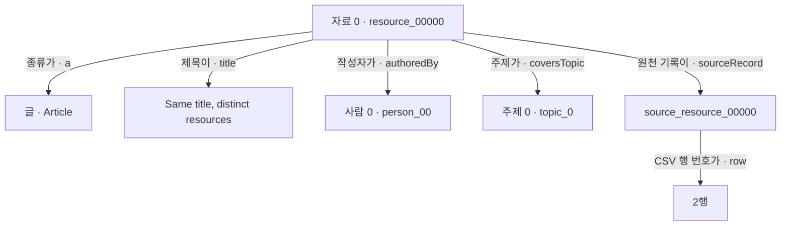
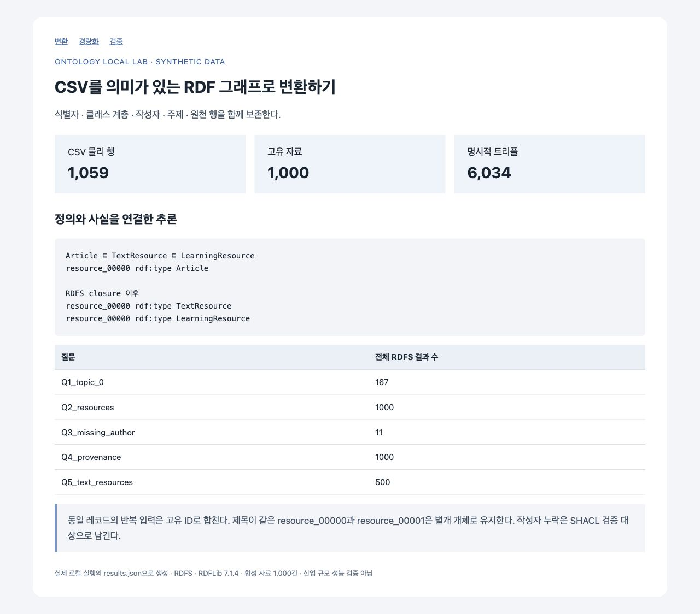
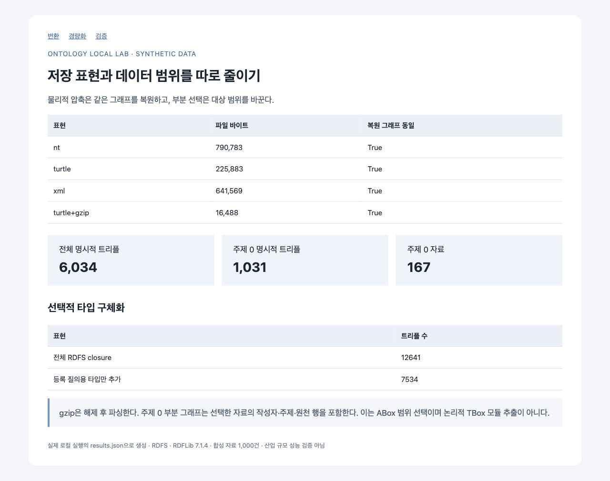
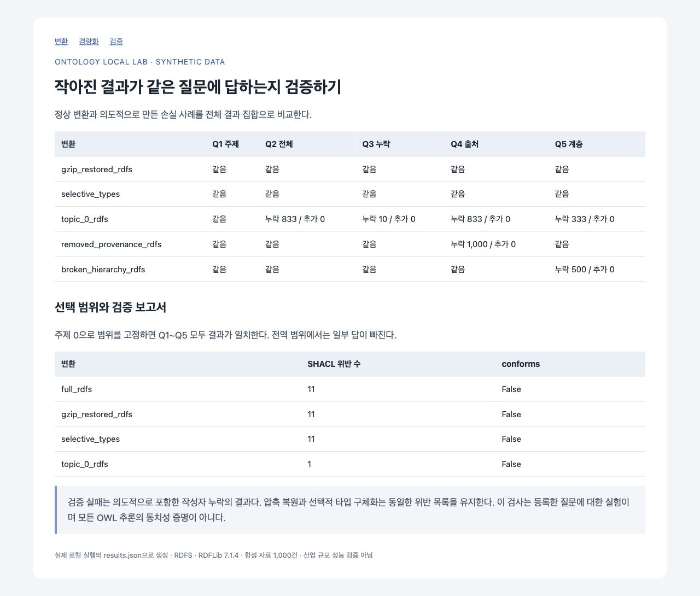

# 온톨로지 경량화 실습 자료

**스터디에서 읽을 글과 들을 강의를 모아 둔 목록**을 생각해 보세요. 자료마다 제목, 작성자, 주제가 있습니다. 글과 강의를 함께 찾기도 하고, 작성자를 빠뜨린 자료를 찾기도 합니다.

이 실습은 그 목록을 그래프로 옮긴 뒤 **원천 사실과 분류 정의를 유지하면서, 조회에 필요한 추론 결과만 저장해도 같은 답을 얻는지** 확인합니다. 특정 주제의 자료만 쓰는 경우에는 필요한 연결까지 포함한 작은 그래프를 따로 만들고, 그 범위에서 답을 비교합니다. 모든 입력은 실습용으로 만든 가상 자료입니다.

## 처음에는 이 순서로 보세요

전체 내용을 공유할 때는 **[종합 정리 한 편](https://medium.com/p/7af38ac8a50d)**부터 읽으면 됩니다. 원천과 정의를 남기고 저장할 추론 결과를 고르는 이유와 20건 실습 결과를 한 글에 모았습니다. Medium 글은 현재 미게시 초안이며 읽기 링크는 공개 후 이용할 수 있습니다. 직접 실행하려면 아래 순서를 따르세요.

처음 한 번은 아래 다섯 단계만 따라가면 됩니다. 이 README의 예제 설명을 읽은 뒤 작은 파일부터 여세요.

| 순서 | 볼 곳 | 확인할 질문 |
| --- | --- | --- |
| 1 | 이 README의 ‘트리플과 지식 그래프의 뜻’부터 읽기 | 목록 한 행은 무엇을 뜻할까? |
| 2 | [source-20.csv](source-20.csv) | 글·강의 20건에 제목·작성자·주제가 어떻게 적혀 있을까? |
| 3 | [ontology.ttl](ontology.ttl) | 글과 강의를 어떤 종류로 분류하고, 관계에 어떤 뜻을 부여했을까? |
| 4 | [graph-20.ttl](graph-20.ttl)에서 resource_00000 찾기 | 같은 자료 한 건이 그래프에서는 어떻게 표현될까? |
| 5 | 아래 ‘20건으로 실행해 보기’ | 변환·경량화 후에도 같은 자료를 찾을까? |

전체 Python 코드를 이해하는 작업은 이 순서 뒤에 두었습니다. 1,000건·5,000건 자료와 상세 JSON은 작은 예제를 본 뒤 비교할 때 쓰면 됩니다.

## 예제에 들어 있는 것

목록에는 **글 10개와 강의 10개**가 있습니다. 같은 입력의 반복을 확인하려고 두 행을 더 넣었으므로 CSV에는 헤더를 제외하고 22행이 있습니다.

| 예제의 이름 | 뜻 |
| --- | --- |
| resource_00000 같은 ID | 글이나 강의 하나를 가리키는 자료 번호 |
| Article | 글 |
| Course | 강의 |
| TextResource | 글처럼 텍스트로 된 자료라는 상위 분류 |
| LearningResource | 글과 강의를 함께 부르는 학습 자료라는 상위 분류 |
| person_00 같은 ID | 작성자를 구별하는 번호 |
| topic_0 같은 ID | 자료의 주제를 구별하는 번호 |
| source_resource_00000 | 이 자료가 원천 CSV의 어느 행에서 왔는지 가리키는 기록 |

person_00에 실제 사람 이름이 붙어 있거나 topic_0가 특정 기술을 뜻하는 것은 아닙니다. **작성자와 주제의 연결을 시험하기 위한 임의의 번호**입니다. Learning material 2 같은 제목도 실제 문서 제목이 아닌 생성된 문자열입니다.

## 트리플과 지식 그래프의 뜻

‘자료 0의 작성자는 사람 0이다’를 `(자료 0, 작성자가, 사람 0)`으로 나누어 적을 수 있습니다. 설명할 대상인 주어, 관계를 나타내는 술어, 연결할 대상이나 값인 목적어라는 세 자리를 묶은 것이 트리플입니다. 자료 한 건에도 종류·제목·작성자·주제 등 여러 사실이 있으므로 자료 1건과 트리플 1개는 같은 수가 아닙니다.

자료 0에서 작성자와 주제에 연결선을 그리면 지식 그래프가 됩니다. 연결의 양 끝을 노드, 그 사이의 관계를 간선이라고 부릅니다. 이 실습은 트리플을 다루는 표준 데이터 모델인 RDF로 그래프를 만들고, 종류와 관계의 뜻을 정한 온톨로지를 함께 사용합니다. RDF의 파일 표기법 중 하나가 Turtle(.ttl)입니다.

경량화는 정한 범위에서 필요한 질문에 계속 답하면서 저장 공간이나 계산 부담을 줄이는 작업입니다. 다음 예제에서는 저장할 추론 결과를 선택하는 방법과 사용할 자료의 범위를 좁히는 방법을 다룹니다. 파일 포맷과 gzip은 별도의 보관 실험입니다. [W3C RDF 입문 설명](https://www.w3.org/TR/rdf11-primer/#section-triple)

## 왜 사실을 세 자리로 나눌까

CSV에서는 자료 한 건의 종류·제목·작성자·주제를 한 행에 모았습니다. RDF로 옮길 때는 그 내용을 관계별로 나눕니다. ‘자료 0의 작성자는 사람 0이다’를 예로 들면 다음 세 자리가 필요합니다.

```text
(자료 0, 작성자가, 사람 0)
   주어     술어     목적어
```

주어(subject)는 설명할 대상, 술어(predicate)는 어떤 관계인지, 목적어(object)는 연결할 개체나 값입니다. 세 자리를 묶은 RDF의 단위를 트리플(triple)이라고 합니다. 그래프로 그리면 자료 0과 사람 0이 양쪽 노드가 되고, authoredBy가 둘을 잇는 화살표의 이름이 됩니다. [W3C RDF의 트리플 정의](https://www.w3.org/TR/rdf11-concepts/#section-triples)

세 자리의 순서에도 뜻이 있습니다. ‘자료 0 → 작성자가 → 사람 0’에서 앞뒤를 바꾸면 ‘사람 0의 작성자가 자료 0이다’라는 다른 주장입니다. 세 값을 순서 없이 모아 두는 것과는 다릅니다.

이렇게 나누면 작성자가 같은 여러 자료를 같은 사람 식별자에 연결할 수 있습니다. ‘사람 0이 작성한 자료는 무엇인가?’를 물을 때는 authoredBy의 목적어가 person_00인 연결을 찾으면 됩니다. 자료에 주제나 출처를 덧붙일 때도 같은 자료 식별자를 주어로 둔 트리플을 추가합니다. 제목은 문자열 값에, 작성자는 사람 개체에 연결한다는 차이도 각 관계에 드러납니다.

Python 코드의 튜플(tuple)은 값을 순서대로 묶는 표현입니다. 이 실습에서 RDFLib의 g.add()는 트리플 한 개를 나타내는 세 값의 튜플을 받습니다. 아래 코드는 앞의 작성자 관계를 그래프에 추가합니다. EX와 g는 실습 코드에서 정의한 네임스페이스와 그래프입니다.

```python
g.add((EX.resource_00000, EX.authoredBy, EX.person_00))
```

안쪽 괄호의 세 값이 하나의 튜플이고, 바깥 괄호는 g.add()를 호출하는 괄호입니다. **트리플은 RDF에서 무엇을 표현하는지에 관한 말이고, 튜플은 여기서 그 값을 Python 함수에 전달하는 방식**입니다. [RDFLib 7.1.4의 add() 설명](https://rdflib.readthedocs.io/en/7.1.4/intro_to_creating_rdf.html#adding-triples-to-a-graph)

이번 실습은 RDF를 사용하므로 이 구조로 읽습니다. 온톨로지의 모든 구현이 Python 튜플을 사용해야 한다는 뜻은 아닙니다. 세 자리로 나누기만 해도 의미가 정의되거나 추론이 실행되는 것은 아니며, 종류와 관계의 정의는 뒤에서 ontology.ttl로 확인합니다. **트리플로 변환하는 일 자체도 경량화는 아닙니다.** CSV 한 행이 여러 트리플로 바뀌므로 개수가 늘 수 있고, 무엇을 줄여도 되는지는 필요한 질문을 정한 뒤 판단합니다.

## TTL 파일을 처음 읽을 때

.ttl은 Turtle 형식의 확장자입니다. 웹 표준 기구 W3C가 표준화한 RDF 그래프의 텍스트 표기법으로, 자료 사이의 관계를 파일에 적는 문법입니다. 이 실습에서는 Python의 RDFLib가 이 형식을 읽고 씁니다. [W3C Turtle 표준](https://www.w3.org/TR/turtle/)

Turtle 문법은 표준이고, ex:Article이나 ex:authoredBy 같은 학습 자료의 개념·관계 이름은 이 예제에서 정했습니다. ontology.ttl에는 분류·관계의 정의, graph-20.ttl에는 개별 자료의 사실, shapes.ttl에는 데이터 검사 조건을 같은 Turtle 문법으로 적었습니다.

먼저 한 문장을 읽어 보세요.

```turtle
@prefix ex: <https://example.org/learning/> .

ex:resource_00000 ex:authoredBy ex:person_00 .
```

둘째 문장은 ‘자료 0의 작성자는 사람 0이다’라는 뜻입니다. **끝의 마침표(.)는 Turtle 문장이 끝났다는 표시**입니다. 줄바꿈만으로는 문장이 끝나지 않습니다. 첫 줄의 @prefix 선언도 마침표로 끝납니다. [Turtle의 기본 문장](https://www.w3.org/TR/turtle/#simple-triples)

같은 자료에 대한 사실을 이어 적을 때는 세미콜론(;)을 사용합니다.

```turtle
ex:resource_00000 ex:authoredBy ex:person_00 ;
    ex:coversTopic ex:topic_0 .
```

위 문장은 ‘자료 0의 작성자는 사람 0이다’와 ‘자료 0은 주제 0을 다룬다’라는 **두 사실**을 묶어 적은 것입니다. 세미콜론 뒤에서는 맨 앞의 자료 번호를 다시 쓰지 않습니다. 마지막 마침표에서 문장을 닫습니다. 따라서 마침표 하나가 항상 사실 하나와 대응하는 것은 아닙니다. [같은 주어의 사실 이어 쓰기](https://www.w3.org/TR/turtle/#predicate-lists)

| 기호 | 읽는 법 |
| --- | --- |
| @prefix ex: | 공통 주소에 ex:라는 줄임말을 붙인다. |
| ex:resource_00000 | ex:의 공통 주소 뒤에 자료 번호를 붙인 식별자다. |
| a | ‘이 종류에 속한다’는 뜻으로, 표준 rdf:type의 줄임말이다. |
| ; | 같은 자료에 대한 다음 사실을 이어 적는다. |
| . | 이 Turtle 문장을 끝낸다. |
| "제목" | 따옴표 안의 문자열 값이다. |

## 자료 한 건을 옮겨 보기

[source-20.csv](source-20.csv)의 첫 자료는 다음과 같습니다.

```csv
id,kind,title,author,topic
resource_00000,Article,"Same title, distinct resources",person_00,topic_0
```

이 한 행을 사람 말로 읽으면 다음과 같습니다.

> 자료 0은 글이다. 제목은 ‘Same title, distinct resources’이고, 작성자는 사람 0이다. 주제 0을 다룬다.

그래프에서는 이 문장을 관계별로 나눠 연결합니다. 아래 그림은 **자료 0 한 건의 사실**입니다.



[graph-20.ttl](graph-20.ttl)에서 그 자료를 찾으면 다음과 같이 적혀 있습니다. 이 단계에서는 기호마다 한국어 문장으로 읽어 보면 충분합니다.

```turtle
ex:resource_00000 a ex:Article ;
    dct:title "Same title, distinct resources" ;
    ex:authoredBy ex:person_00 ;
    ex:coversTopic ex:topic_0 ;
    ex:sourceRecord ex:source_resource_00000 .
```

ex:는 파일 위쪽에 선언한 공통 주소의 줄임말입니다. a는 ‘이 종류에 속한다’, 세미콜론은 ‘같은 자료에 대해 다음 사실도 적는다’는 뜻으로 읽습니다. 제목은 문자열 값이고 작성자·주제는 각각 다른 개체의 ID를 가리킵니다.

원천 기록에는 CSV 행 번호가 들어갑니다. 헤더가 1행이고 자료 0이 처음 나온 위치가 2행이므로, 자료 0 → 원천 기록 → 2행으로 따라갈 수 있습니다.

## 여기서 온톨로지는 어느 부분일까

[ontology.ttl](ontology.ttl)은 **자료를 어떤 종류로 분류하고, 관계를 어떤 뜻으로 사용할지 정한 파일**입니다. 자료 0의 제목과 작성자 같은 개별 사실은 graph-20.ttl에 들어갑니다.

이 예제에서는 종류를 아래처럼 정의했습니다. 아래 나무는 분류 관계이며, 위의 자료 0 그림은 개별 자료의 사실입니다.

```text
학습 자료 · LearningResource
├─ 텍스트 자료 · TextResource
│  └─ 글 · Article
└─ 강의 · Course
```

여기서 TBox는 ‘모든 글은 텍스트 자료다’처럼 여러 자료에 적용할 분류 정의를 말합니다. ABox는 ‘자료 0은 글이다’처럼 특정 자료에 관한 사실입니다. TBox의 T는 Terminological, ABox의 A는 Assertional에서 왔습니다. Box는 별도 파일 형식이 아니라 문장의 역할을 구분하는 이름입니다.

글과 강의를 ‘학습 자료’로 함께 찾으려면 무엇을 그 분류에 포함할지 정해야 합니다. 코드마다 같은 조건을 따로 두는 대신, 이 예제에서는 공통 정의를 읽고 개별 자료에 적용합니다. 개별 사실을 지우는 것과 여러 자료의 해석에 쓰는 정의를 지우는 것의 영향이 다른 이유도 여기에 있습니다.

자료 0에 직접 적은 종류는 Article입니다. 분류 정의를 적용하면 ‘글이므로 TextResource이고, 따라서 LearningResource이기도 하다’고 알 수 있습니다. 이 실습에서는 그 결론을 RDFS 추론으로 추가합니다.

그래서 LearningResource를 찾는 [Q2_resources.rq](Q2_resources.rq)가 글과 강의 20건을 함께 반환합니다. **그냥 CSV 열을 옮기는 데서 한 걸음 더 나아가, 정의에 따라 상위 종류도 찾아보는 것**이 이 예제의 온톨로지 학습 지점입니다.

질문은 다음 다섯 가지입니다. 먼저 Q2와 Q4만 읽어도 예제의 목적을 확인할 수 있습니다.

| 질문 | 질의 파일 | 20건 기준 답 |
| --- | --- | --- |
| 주제 0의 자료는 무엇인가? | [Q1_topic_0.rq](Q1_topic_0.rq) | 4건 |
| 글과 강의를 합친 모든 학습 자료는 무엇인가? | [Q2_resources.rq](Q2_resources.rq) | 20건 |
| 작성자를 적지 않은 자료는 무엇인가? | [Q3_missing_author.rq](Q3_missing_author.rq) | 1건 |
| 각 자료는 CSV의 어느 행에서 왔는가? | [Q4_provenance.rq](Q4_provenance.rq) | 20건의 원천 위치 |
| 텍스트 자료에 속하는 글은 무엇인가? | [Q5_text_resources.rq](Q5_text_resources.rq) | 10건 |

작성자 누락 등 데이터가 갖춰야 할 조건은 [shapes.ttl](shapes.ttl)에 따로 적었습니다. **종류를 알아내는 정의와 누락을 검사하는 조건**을 각각 살펴보는 구성입니다.

## 일부러 넣은 세 가지 사례

| CSV에서 볼 곳 | 넣은 이유 | 확인할 점 |
| --- | --- | --- |
| resource_00000이 연속으로 두 번 등장 | 같은 자료를 반복해서 가져온 상황 | 동일 ID·동일 내용은 한 자료로 정리한다. |
| resource_00000과 resource_00001의 제목이 같음 | 제목은 같지만 하나는 글, 하나는 강의인 상황 | 제목만 보고 두 자료를 합치면 안 된다. |
| resource_00007의 author가 비어 있음 | 작성자를 빠뜨린 자료가 들어온 상황 | 누락을 감추지 않고 검증 결과에 남긴다. |

20건 입력에는 resource_00017의 반복도 있습니다. 이 두 반복 행을 정리하면 자료는 20건입니다. 작성자 누락 1건은 의도한 입력이어서 SHACL 검증에서 위반으로 나오는 것이 예상 결과입니다.

## 이 예제로 무엇을 줄여 볼까

### 원천과 정의는 남기고, 저장할 결론을 고른다

자료에 `Article`이라고 적으면 분류 정의를 통해 `TextResource`와 `LearningResource`에도 속한다는 결론을 얻습니다. RDFS 추론은 이런 결론 외에도 관계의 정의에서 따라오는 타입 등을 추가합니다. 모두 저장해 두면 조회할 때 다시 계산할 필요는 줄지만 저장할 트리플은 늘어납니다.

이번 실습에서는 전체 자료·텍스트 자료 조회에 필요한 두 상위 타입만 추가합니다. 자료의 제목·작성자·주제·출처와 분류 정의는 그대로 둡니다.

| 20건 예제의 그래프 | 들어 있는 내용 | 트리플 수 |
| --- | --- | ---: |
| 입력 그래프 `graph.ttl` | 원천에서 옮긴 사실 + 온톨로지 정의 | 163 |
| 전체 RDFS 결과 | 입력 그래프 + 적용한 RDFS 규칙으로 얻은 전체 결론 | 397 |
| 선택적 타입 그래프 `selective-types.ttl` | 입력 그래프 + LearningResource 타입 20개 + TextResource 타입 10개 | 193 |

**저장량 비교는 397 → 193입니다.** 입력 그래프 163개에서 원천 사실을 삭제한 것이 아니라, 전체 추론 결과를 저장할 때보다 204트리플 적게 저장합니다. 같은 20건의 자료를 대상으로 다섯 질의의 결과 집합과 작성자 누락 검사를 비교합니다.

생략한 결론은 남겨 둔 원천·정의와 같은 규칙으로 다시 계산할 수 있습니다. 다만 현재 조회 코드가 자동으로 추가 추론을 해 주지는 않습니다. 새로운 질의에 다른 결론이 필요하다면 저장할 타입이나 조회 시 추론 방식을 다시 정해야 합니다.

현재 코드는 **전체 RDFS 결과를 먼저 계산한 뒤 필요한 타입을 고릅니다.** 이번에 줄인 것은 저장할 트리플 수입니다. 준비 단계의 추론 비용이나 최대 메모리가 줄었다는 실험은 아닙니다. 1,000건에서는 전체 결과 12,641개 대신 7,534개를 저장했고, 5,000건에서는 62,600개 대신 37,493개를 저장했습니다.

### 특정 주제만 쓸 때는 그래프의 사용 범위를 좁힌다

주제 0 화면에 쓸 그래프도 따로 만듭니다. 전체 20건 중 해당 자료 4건과 연결된 작성자·주제·출처를 복사하고, 분류 정의도 함께 둡니다. 명시적 트리플은 163개에서 48개가 됩니다. 원천 전체는 보존하고, 사용할 부분 그래프를 따로 만든 결과입니다.

여기서는 **선택한 4건에 대한 답**이 유지되는지 봅니다. 전체 자료 조회가 20건에서 4건으로 바뀌므로, 전체 데이터의 답을 보존한 압축으로 해석하면 안 됩니다. 더 긴 관계 경로를 쓰는 데이터라면 관련 정보를 가져오는 규칙도 달라져야 합니다.

### 파일 압축과 정보 손실도 별도로 확인한다

gzip은 같은 그래프 파일을 작게 보관하고 읽을 때 복원하는 보조 실험입니다. 저장할 사실이나 추론 결과를 고르는 위의 작업과 측정 대상이 다릅니다.

출처 연결을 지우는 실험과 글의 분류 관계를 끊는 실험은 손실을 찾는 검사가 동작하는지 확인하기 위한 것입니다. 각각 ‘원천 행 찾기’와 ‘텍스트 자료 찾기’의 답이 사라져야 합니다. 단순히 작아졌다는 이유로 경량화 성공 사례에 포함하지 않습니다.

## 20건으로 실행해 보기

실행 전에 위의 CSV 한 행과 그래프 한 건을 먼저 읽어 보세요. 그 다음 저장소의 **Code → Download ZIP**으로 전체 자료를 받아 압축을 풀고, run_lab.py가 있는 폴더에서 실행합니다. Python 3.12를 사용합니다.

macOS·Linux:

```bash
python3 -m venv .venv
.venv/bin/python -m pip install -r requirements.txt
.venv/bin/python run_lab.py --records 20 --repeats 3
python3 -m http.server 18769 --bind 127.0.0.1
```

Windows PowerShell:

```powershell
py -3.12 -m venv .venv
.\.venv\Scripts\python.exe -m pip install -r requirements.txt
.\.venv\Scripts\python.exe run_lab.py --records 20 --repeats 3
.\.venv\Scripts\python.exe -m http.server 18769 --bind 127.0.0.1
```

### 서버를 켠 다음 무엇을 열까

`run_lab.py`가 CSV 생성 → RDF 변환 → RDFS 추론 → 저장할 타입 선택·주제 범위 선택·파일 보관 비교 → 질의·SHACL 검증을 모두 실행한 뒤 결과 파일을 만듭니다. 실행이 끝나 터미널에 결과 요약과 다음 명령을 입력할 줄이 나타나면 계산이 끝난 것입니다.

그다음 실행하는 `http.server`는 이미 만든 HTML 파일을 브라우저에 보여 줍니다. 서버를 켠 터미널이 계속 실행 중인 것은 요청을 기다리는 상태입니다. 브라우저 새로고침은 실험을 다시 실행하는 명령이 아닙니다.

[http://127.0.0.1:18769/](http://127.0.0.1:18769/)에는 파일 목록이 나타납니다. 여기서는 `run-20/` 폴더를 누른 뒤 `04-conversion.html`을 여세요. 아래 링크로 바로 열어도 됩니다. 결과 화면 위의 **변환 → 경량화 → 검증** 링크로 다음 화면에 이동할 수 있습니다.

| 순서 | 열 주소 | 먼저 확인할 것 |
| --- | --- | --- |
| 1. 변환 | [04-conversion.html](http://127.0.0.1:18769/run-20/04-conversion.html) | CSV 22행 → 고유 자료 20건, 명시적 트리플 163개. 표의 Q2 전체 자료는 20건, Q5 글은 10건인지 본다. |
| 2. 경량화 | [05-lightening.html](http://127.0.0.1:18769/run-20/05-lightening.html) | **선택적 타입 구체화 표의 397 → 193트리플**을 먼저 본다. 주제 선택의 163 → 48트리플·자료 4건은 범위를 좁힌 결과다. 파일 바이트 표는 보조 실험이다. |
| 3. 검증 | [06-verification.html](http://127.0.0.1:18769/run-20/06-verification.html) | **selective_types의 Q1~Q5가 모두 ‘같음’인지** 본다. 주제 선택과 의도적인 손실, 압축 복원 행은 아래 기준으로 해석한다. |

경량화 화면은 파일 바이트 표부터 나오지만, 이번 핵심 비교는 아래의 **선택적 타입 구체화** 표입니다. **복원 그래프 동일 = True**는 파일 표현이나 압축을 바꿔도 같은 트리플로 복원됐다는 보조 실험 결과입니다. 파일 바이트·부분 그래프의 트리플·저장할 추론 결과는 서로 다른 수치이므로 하나의 압축률로 합치지 않습니다.

검증 화면의 행 이름은 다음 실험을 가리킵니다. ‘누락’이나 `False`가 보인다고 모두 프로그램 오류인 것은 아닙니다.

| 화면의 행 | 한 일 | 20건 실행에서 기대할 결과 |
| --- | --- | --- |
| selective_types | 원천·정의를 유지하고 필요한 두 상위 타입만 추가해 저장 | Q1~Q5가 모두 같음 |
| gzip_restored_rdfs | 보조 실험: gzip을 풀어 원래 그래프를 복원 | Q1~Q5가 모두 같음 |
| topic_0_rdfs | 주제 0의 자료 4건만 선택 | 전체 20건 기준 Q2는 16건 누락. 선택한 4건으로 범위를 맞추면 Q1~Q5가 같음 |
| removed_provenance_rdfs | 일부러 출처 연결을 제거 | Q4 출처가 20건 누락되어야 함 |
| broken_hierarchy_rdfs | 일부러 Article → TextResource 정의를 제거 | Q5 계층에서 글 10건이 누락되어야 함 |

아래 SHACL 표에서 전체 그래프의 **위반 1건과 conforms=False**는 의도적으로 작성자를 비워 둔 자료를 찾은 결과입니다. 주제 0 그래프의 위반은 0건이지만, 누락을 고친 것이 아니라 해당 자료가 선택 범위에서 빠진 것입니다.

### 결과를 다시 실행해 보고 싶다면

서버를 켠 터미널은 그대로 두고 **새 터미널에서 같은 실습 폴더를 엽니다.** 그곳에서 계산 명령을 다시 실행합니다.

macOS와 Linux:

```bash
.venv/bin/python run_lab.py --records 20 --repeats 3
```

Windows PowerShell:

```powershell
.\.venv\Scripts\python.exe run_lab.py --records 20 --repeats 3
```

실행이 끝나면 위의 `run-20` 결과 페이지를 새로고침합니다. 같은 자료 수로 다시 실행하면 같은 폴더의 결과 파일을 다시 씁니다. 생성 규칙이 같으므로 자료 수와 질의 결과는 같고, 시간이나 직렬화한 파일 크기는 달라질 수 있습니다.

자료를 늘리려면 `--records 20`을 `--records 1000`으로 바꿉니다. 이때는 `run-1000` 폴더가 생기므로 [1,000건 변환 화면](http://127.0.0.1:18769/run-1000/04-conversion.html)부터 여세요. `run-20` 화면을 새로고침하는 것만으로 1,000건 결과로 바뀌지는 않습니다.

확인을 마치면 서버를 실행한 터미널에서 Ctrl+C로 종료합니다. 상세 기록은 이번 실행의 `run-20/results.json`과 제공한 [expected-20.json](expected-20.json)을 비교하면 됩니다.

run_lab.py는 원천 CSV를 매번 같은 규칙으로 생성하고 run-20 폴더에 결과를 씁니다. 제공한 source-20.csv를 직접 수정해도 그 파일이 자동으로 입력되는 구조는 아닙니다.

## 생성된 그래프 파일 읽는 법

이 실습의 추론에는 **LLM을 쓰지 않습니다.** `owlrl`이 입력된 사실과 RDFS 규칙을 적용해 결론을 계산합니다. 아래 두 파일을 비교하면 어떤 결론을 추가했는지 직접 읽을 수 있습니다.

| 실행 후 생기는 파일 | 담긴 내용 | 먼저 찾을 것 |
| --- | --- | --- |
| `run-20/graph.ttl` | CSV에서 옮긴 사실과 공통 분류 정의 | 자료 0의 원래 타입 `Article`과 작성자·주제·출처 |
| `run-20/selective-types.ttl` | 같은 사실·정의에 필요한 두 상위 타입만 추가한 그래프 | 자료 0에 추가된 `TextResource`, `LearningResource` |

두 파일은 에디터로 열면 됩니다. 저장소 루트의 [graph-20.ttl](graph-20.ttl)은 제공한 입력의 변환 사본이고, `run-20/graph.ttl`은 직접 실행해서 만든 결과입니다. 1,000건을 실행했다면 같은 파일들이 `run-1000` 폴더에 있습니다.

### 먼저 같은 자료 한 건을 찾는다

`graph.ttl`에서 `ex:resource_00000`을 찾습니다. 아래는 그 자료의 내용을 발췌한 것입니다. `ex:`와 `dct:`의 전체 주소는 파일 맨 위의 `@prefix`에 선언돼 있습니다.

```turtle
ex:resource_00000 a ex:Article ;
    dct:title "Same title, distinct resources" ;
    ex:authoredBy ex:person_00 ;
    ex:coversTopic ex:topic_0 ;
    ex:sourceRecord ex:source_resource_00000 .
```

이 블록은 자료 0이 **글(Article)**이고, 작성자는 `person_00`, 주제는 `topic_0`, 출처는 `source_resource_00000`이라는 뜻입니다. `a`는 타입을 나타내는 `rdf:type`의 줄임말입니다. 세미콜론으로 이어진 각 줄은 같은 자료에 관한 다른 사실입니다.

출처가 궁금하면 같은 파일에서 `ex:source_resource_00000`이 주어인 부분을 찾습니다.

```turtle
ex:source_resource_00000 ex:row 2 .
```

이 자료가 이번 실행의 `source.csv` 2행에서 왔다는 뜻입니다. CSV 헤더가 1행이므로 첫 자료는 2행입니다. 이렇게 식별자를 따라가면 자료에서 원천 위치까지 연결해 읽을 수 있습니다.

### 추론 후에는 무엇이 추가됐는지 비교한다

이번에는 `selective-types.ttl`에서 **같은 `ex:resource_00000`**을 찾습니다.

```turtle
ex:resource_00000 a ex:Article,
        ex:LearningResource,
        ex:TextResource ;
    dct:title "Same title, distinct resources" ;
    ex:authoredBy ex:person_00 ;
    ex:coversTopic ex:topic_0 ;
    ex:sourceRecord ex:source_resource_00000 .
```

작성자·주제·출처는 그대로이고, 타입에 `LearningResource`와 `TextResource`가 추가됐습니다. 여기서 쉼표는 **같은 주어·같은 관계의 목적어를 이어 적는 기호**입니다. 자료 0이 세 종류에 속한다는 세 트리플을 한데 적은 것입니다.

```turtle
ex:resource_00000 a ex:Article .
ex:resource_00000 a ex:LearningResource .
ex:resource_00000 a ex:TextResource .
```

### 추가된 타입의 근거를 찾는다

입력 그래프의 분류 관계만 추려 쓰면 다음과 같습니다. 같은 정의를 [ontology.ttl](ontology.ttl)에서도 확인할 수 있습니다.

```turtle
ex:Article rdfs:subClassOf ex:TextResource .
ex:TextResource rdfs:subClassOf ex:LearningResource .
```

자료 0은 Article이고, Article은 TextResource에 포함되며, TextResource는 LearningResource에 포함됩니다. 이 정의 때문에 자료 0에도 두 상위 타입을 추가할 수 있습니다. 새로운 자료를 만들어 낸 것이 아니라 **같은 자료에 대해 정의에서 따라오는 분류를 계산한 것**입니다.

`resource_00001`도 비교해 보세요. 이 자료는 Course이므로 `LearningResource`는 추가되지만 `TextResource`는 추가되지 않습니다.

20건 실행에서 `graph.ttl`은 163트리플, `selective-types.ttl`은 193트리플입니다. 학습 자료 타입 20개와 글의 텍스트 자료 타입 10개가 추가된 차이입니다. 전체 RDFS 추론 결과 397트리플은 실행 중 메모리에서 만들어 검증에 사용하며, 두 번째 파일에는 그 전체가 아니라 **이번 다섯 질문에 필요한 두 타입만 골라 저장**합니다.

파일을 다시 저장하면 줄이나 타입의 나열 순서가 달라질 수 있습니다. 줄 번호보다 **같은 자료 식별자에 어떤 사실이 적혀 있는지**를 기준으로 비교하면 됩니다.

## 그다음에 읽을 것

예제 한 건을 이해한 뒤에는 아래 종합 글에서 전체 흐름을 읽고, 필요한 개념이나 코드만 상세 글에서 찾아보세요. 상세 글의 1,000건 캡처는 자료 수만 늘린 같은 구조입니다.

## Medium 공부 글

공유용 종합 글 한 편과 필요한 부분만 찾아볼 상세 글 여섯 편입니다. **현재 모두 퇴고 중인 미게시 초안입니다. 아래 읽기 링크는 글을 공개한 뒤 이용할 수 있습니다.**

| 편 | 내용 | Medium |
| --- | --- | --- |
| 종합 | 온톨로지 데이터 경량화에서 줄이는 것과 남기는 것 | [읽기](https://medium.com/p/7af38ac8a50d) |
| 1 | 글도 학습 자료라는 걸 컴퓨터는 알까 | [읽기](https://medium.com/p/497e0088da64) |
| 2 | 무엇을 남기고 무엇을 다시 계산할까 | [읽기](https://medium.com/p/864c47c51afb) |
| 3 | 줄인 뒤에도 같은 답을 얻으려면 | [읽기](https://medium.com/p/6bb29a46886a) |
| 4 | CSV를 RDF 그래프로 옮겨 보기 | [읽기](https://medium.com/p/edc0073b6ff6) |
| 5 | 필요한 추론 결과만 저장하기 | [읽기](https://medium.com/p/892a4539be5d) |
| 6 | 줄인 뒤에도 같은 답이 나오는지 확인하기 | [읽기](https://medium.com/p/1007ee5729d3) |

종합 글만으로 문제·개념·실험·결론을 읽을 수 있습니다. 더 확인할 때는 **개념 1·2편, 보존 기준과 검사 3·6편, 변환과 저장 실습 4·5편** 중 필요한 글을 고르세요.

## 파일을 더 찾아볼 때

<details>
<summary>제공한 25개 파일의 용도 펼치기</summary>

## 파일 구성

파일 이름을 누르면 저장소에서 내용을 확인할 수 있습니다.

| 파일 | 담긴 내용 | 사용할 때 |
| --- | --- | --- |
| [README.md](README.md) | 공부 글 링크, 파일 설명, 실행 순서와 결과 해석 | 처음 시작할 때 |
| [run_lab.py](run_lab.py) | CSV 생성 → RDF 변환 → 추론 → 경량화 → 질의·SHACL 비교 → 결과 화면 생성 | 실습 전체를 실행할 때 |
| [requirements.txt](requirements.txt) | RDFLib 7.1.4, OWL-RL 7.1.4, pySHACL 0.30.1 버전 | Python 패키지를 설치할 때 |
| [ontology.ttl](ontology.ttl) | 학습 자료·글·강의·작성자·주제·출처의 정의와 클래스 계층 | RDF 변환과 RDFS 추론의 기준을 읽거나 수정할 때 |
| [shapes.ttl](shapes.ttl) | LearningResource에 작성자·제목·원천 연결이 있어야 한다는 SHACL 규칙 | 누락 데이터를 검증할 때 |
| [source-20.csv](source-20.csv) | 고유 자료 20건, 반복 행을 포함한 물리 입력 22행 | 작은 입력을 직접 읽어 볼 때 |
| [source-1000.csv](source-1000.csv) | 고유 자료 1,000건, 물리 입력 1,059행 | 글의 결과와 같은 규모를 확인할 때 |
| [source-5000.csv](source-5000.csv) | 고유 자료 5,000건, 물리 입력 5,295행 | 자료 수를 늘려 같은 구조를 비교할 때 |
| [graph-20.ttl](graph-20.ttl) | 20건을 변환한 명시적 RDF 그래프, 정의 포함 163트리플 | CSV 한 행이 어떤 사실로 변환됐는지 읽을 때 |
| [graph-1000.ttl](graph-1000.ttl) | 1,000건을 변환한 명시적 RDF 그래프, 정의 포함 6,034트리플 | 경량화 전의 그래프를 살펴볼 때 |
| [topic-0-1000.ttl](topic-0-1000.ttl) | 주제 0의 167건과 작성자·주제·원천 연결·정의, 1,031트리플 | 전체 그래프와 선택 범위의 차이를 볼 때 |
| [selective-types-1000.ttl](selective-types-1000.ttl) | 명시적 그래프에 LearningResource·TextResource 타입만 추가한 7,534트리플 | 필요한 추론 결과만 저장한 사례를 볼 때 |
| [Q1_topic_0.rq](Q1_topic_0.rq) | 주제 0에 연결된 자료를 찾는 SPARQL 질의 | 주제 선택이 답을 유지하는지 검사할 때 |
| [Q2_resources.rq](Q2_resources.rq) | LearningResource 타입의 전체 자료를 찾는 질의 | 상위 타입 추론과 전체 자료 수를 검사할 때 |
| [Q3_missing_author.rq](Q3_missing_author.rq) | LearningResource 중 작성자 관계가 없는 자료를 찾는 질의 | 누락 사례가 그대로 남았는지 검사할 때 |
| [Q4_provenance.rq](Q4_provenance.rq) | 자료·원천 레코드·CSV 행 번호를 함께 찾는 질의 | 출처 연결이 사라졌는지 검사할 때 |
| [Q5_text_resources.rq](Q5_text_resources.rq) | TextResource 타입의 글을 찾는 질의 | Article의 클래스 계층을 바꿨을 때 답이 달라지는지 검사할 때 |
| [expected-20.json](expected-20.json) | 20건 실행의 트리플 수, 질의 비교, 위반 목록, 측정 조건 | 작은 실행의 결과 기준을 확인할 때 |
| [expected-1000.json](expected-1000.json) | 원고와 캡처에 사용한 1,000건 실행 기록 | 글의 숫자와 재실행 결과를 비교할 때 |
| [expected-5000.json](expected-5000.json) | 5,000건 실행 기록 | 규모를 늘린 반복 실험을 확인할 때 |
| [04-conversion.jpg](04-conversion.jpg) | 1,000건 CSV → RDF 변환 결과 캡처 | 4편 실습 결과를 미리 볼 때 |
| [05-lightening.jpg](05-lightening.jpg) | 저장 표현·부분 선택·선택적 타입 저장 결과 캡처 | 5편의 선택적 타입 저장과 보조 실험 수치를 확인할 때 |
| [06-verification.jpg](06-verification.jpg) | 질의 결과와 SHACL 위반 비교 캡처 | 6편의 보존·손실 검사를 볼 때 |
| [materials-manifest.json](materials-manifest.json) | 자신을 제외한 제공 파일의 바이트 수와 SHA-256 | 받은 파일의 무결성을 확인할 때 |
| [.gitignore](.gitignore) | 가상환경·캐시·재실행 결과 폴더 제외 규칙 | 로컬 실행 결과가 실수로 커밋되는 것을 막을 때 |


</details>

<details>
<summary>1,000건·5,000건 실행, 상세 결과와 측정 범위 펼치기</summary>

## 사용법

### 1. 자료 내려받기

**Code → Download ZIP**으로 받은 ZIP을 풀고 터미널에서 압축을 푼 저장소 폴더로 이동합니다. README.md, run_lab.py, ontology.ttl이 같은 위치에 있어야 합니다.

### 2. 환경 준비와 실행

Python 3.12 환경에서 ZIP을 풀고 이 파일들이 있는 디렉터리에서 실행합니다. 명령은 macOS·Linux 기준입니다. 원고의 실행 환경은 Python 3.12.14, rdflib 7.1.4, owlrl 7.1.4, pyshacl 0.30.1이었습니다.

```bash
python3 -m venv .venv
.venv/bin/python -m pip install -r requirements.txt
.venv/bin/python run_lab.py --records 20 --repeats 3
.venv/bin/python run_lab.py --records 1000 --repeats 3
.venv/bin/python run_lab.py --records 5000 --repeats 3
```

Windows에서는 같은 폴더의 PowerShell에서 다음 순서로 실행할 수 있습니다.

```powershell
py -3.12 -m venv .venv
.\.venv\Scripts\python.exe -m pip install -r requirements.txt
.\.venv\Scripts\python.exe run_lab.py --records 20 --repeats 3
.\.venv\Scripts\python.exe run_lab.py --records 1000 --repeats 3
```

--records는 고유 자료 수이며 최소 20, --repeats는 warm 질의 시간의 반복 측정 수이며 최소 2입니다. 생략하면 각각 1,000과 3으로 실행합니다. 첫 실행은 20건으로 시작하고, 1,000건 실행을 글의 캡처와 비교하면 됩니다.

run_lab.py는 동일한 생성 규칙으로 원천 CSV를 다시 만들고 run-20, run-1000, run-5000 폴더에 변환 결과를 저장합니다. 제공한 source-N.csv는 실행 당시의 입력 사본입니다. 해당 CSV를 직접 수정해 실험하려면 스크립트의 원천 생성 단계와 CSV 읽기 단계를 분리해야 합니다. 수정된 CSV가 자동으로 입력되는 명령이라고 해석하지 마세요.

같은 자료 수로 다시 실행하면 해당 run-N 폴더의 파일을 다시 작성합니다. 보관된 expected-N.json은 작성 당시 실행 기록이므로 입력 사본과 함께 유지하는 편이 좋습니다.

### 3. 생성된 파일 확인

1,000건을 실행하면 run-1000 폴더에 다음 파일이 생깁니다. 20건과 5,000건은 각각 run-20, run-5000에 같은 이름으로 저장됩니다.

| 생성 파일 | 확인할 내용 |
| --- | --- |
| source.csv | 이번 실행에서 생성한 원천 CSV |
| graph.ttl, graph.nt, graph.rdf | 같은 명시적 그래프의 Turtle·N-Triples·RDF/XML 표현 |
| graph.ttl.gz | Turtle의 gzip 압축본; 질의 전 해제 필요 |
| topic-0.ttl | 주제 0의 자료와 지원 연결을 선택한 명시적 그래프 |
| selective-types.ttl | 두 상위 타입만 추가해 보관한 그래프 |
| Q1_topic_0.rq부터 Q5_text_resources.rq까지 | 실행에서 사용하는 다섯 SPARQL 질의 |
| results.json | 이번 실행의 수량, 전체 결과 집합 비교, SHACL 위반, 측정 환경 |
| 04-conversion.html | 변환 결과 요약 화면 |
| 05-lightening.html | 경량화 실험 요약 화면 |
| 06-verification.html | 질의와 SHACL 검증 요약 화면 |

results.json의 answer_checks에서 variant별로 count, same_global_answers, missing, extra를 확인합니다. scope_checks는 주제 0으로 범위를 맞춘 답의 비교이고, shacl은 위반 목록입니다. expected-N.json과 시간·바이트 수까지 완전히 같아야 하는 비교는 아닙니다.

## 예상 결과

| 자료 수 | 반복 행 | 명시적 트리플 | RDFS 확장 트리플 | Q1 주제 0 | Q2 전체 자료 | Q3 작성자 누락 | Q4 출처 | Q5 글 | SHACL 위반 |
| --- | --- | --- | --- | --- | --- | --- | --- | --- | --- |
| 20 | 2 | 163 | 397 | 4 | 20 | 1 | 20 | 10 | 1 |
| 1,000 | 59 | 6,034 | 12,641 | 167 | 1,000 | 11 | 1,000 | 500 | 11 |
| 5,000 | 295 | 29,993 | 62,600 | 834 | 5,000 | 52 | 5,000 | 2,500 | 52 |

SHACL의 conforms=false는 의도적으로 남긴 작성자 누락의 결과입니다. 압축 복원과 선택적 타입 저장은 같은 질의 결과와 같은 위반 목록을 유지합니다. 주제 0의 부분 그래프는 전역 답과 다르지만 선택한 자료의 범위에서는 다섯 질의의 결과가 같습니다.

출처를 제거하면 Q4의 답이 사라지고, Article이 TextResource의 하위 클래스라는 공리를 제거하면 Q5에서 글이 빠지는지도 검사합니다. 프로그램이 끝까지 실행됐다는 것은 손실 사례가 예상대로 검출되는 검사도 통과했다는 뜻입니다.

## 결과 화면

### 4. 브라우저에서 결과 보기

실행 후 이 디렉터리에서 다음 서버를 시작합니다.

```bash
python3 -m http.server 18769 --bind 127.0.0.1
```

- 변환: http://127.0.0.1:18769/run-1000/04-conversion.html
- 경량화: http://127.0.0.1:18769/run-1000/05-lightening.html
- 검증: http://127.0.0.1:18769/run-1000/06-verification.html

Windows에서는 서버 명령의 `python3` 대신 `.\.venv\Scripts\python.exe`를 사용합니다. 확인을 마치면 서버를 실행한 터미널에서 Ctrl+C로 종료합니다.

이 페이지들은 실제 실행 결과를 표시하는 요약 화면입니다. Medium 4–6편의 캡처는 원고 작성 당시 1,000건 실행 화면에서 남겼습니다.

### 변환



### 경량화



### 검증



## 비교할 때 주의할 측정 범위

파일 바이트는 DB 저장량이나 heap 측정값이 아닙니다. gzip은 압축을 푼 뒤 파싱합니다. 직렬화 순서에 따라 재실행한 파일 크기와 압축 크기가 달라질 수 있어 바이트 크기와 시간 측정값을 합격 기준으로 사용하지 않습니다.

선택적 타입 저장은 전체 RDFS 결과를 먼저 계산한 뒤 필요한 타입을 고릅니다. 조회 시간은 준비된 메모리 그래프에서 결과를 끝까지 읽는 warm 측정이며 적재·질의 준비·추론 시간을 제외합니다.

이 실습은 RDFS 추론, ABox 범위 선택, 등록한 다섯 질의의 결과 비교입니다. 전체 OWL DL 추론, OWL 프로필 변환, 형식적 TBox 모듈 추출이나 모든 질의에 대한 동치성 증명으로 설명하지 않습니다.

</details>
